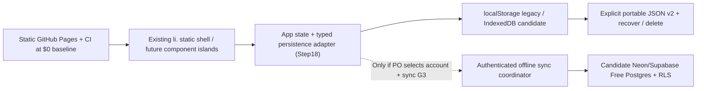

# ADR-016 — G3 Architecture Decision Packet (Review Draft)
**li. (理)** · Research cut: 2026-11-19 · **G3 OPEN / HUMAN PRODUCT OWNER NOT YET APPROVED**

**Authority:** [Product Hub](https://app.notion.com/p/4196cf6db72a81269c71c90c39310334) · [Latest Handoff](https://app.notion.com/p/4196cf6db72a81f7b000f75783f210b5) · [Step16 G3 Backlog](https://app.notion.com/p/4196cf6db72a81379aaccba71303cb75) · [PRD](https://app.notion.com/p/4196cf6db72a81f28b2ae19f59a08b65) · [Design Library entrypoint](../../design-system/README.md) · [AGENTS.md](../../AGENTS.md).

## 0. Executive decision — candidate, not authorization

**Preferred staged direction for review (inference, NOT a selected technology):** preserve GitHub Pages and the working HTML/Vanilla/CSS shell now; isolate app state/persistence interfaces and keep versioned user-controlled JSON export; evaluate **React + TypeScript + Vite as an *incremental* target for NEW complex learning UI, not a big-bang rewrite**. Use browser-local storage with a staged IndexedDB design once Step18 defines entities. Add a remote authentication/database backend **only if the Human PO says accounts or automatic multi-device sync are in the MVP**, with Neon Free and Supabase Free as first proof candidates, rather than committing prematurely.

Why conditional: a 3-lesson UI proof demonstrates compatibility and byte cost, not whether migrating 23 loaded scripts plus existing DOM route/state contracts is safe; local-only preserves $0 and privacy but lacks automatic device sync. Likewise, a published backend free tier is **not evidence that the user's account is eligible, secured or bill-free at scale**.

**This page is a decision packet, not a record that the Human PO approved G3.** G2 visual identity and real Safari usability remain independently gated. Paid incremental spend to date: **0 VND**.

## 1. Measured actual li. source baseline

GitHub public `main` at verified SHA `ee0ea53b0a03683701f61386b3439e17a4b56a31`, November 19, 2026; measurements derived from GitHub repository tree and actual `site/index.html` script/link tags (not guesses):

| Baseline source fact | Verified quantity | Interpretation |
| --- | ---: | --- |
| Root entry `site/index.html` | 108,516 bytes (Git tree) | One interwoven static app route/Settings shell; includes inline app script |
| JS asset scripts directly referenced by root | 23 | Currently eager script tags, includes Lucide and legacy language assets |
| Sum of those JS source blob sizes | 874,256 bytes uncompressed | NOT compressed transfer, JS parsed, or actual browser runtime memory |
| CSS assets directly referenced by root | 12 | Generated tokens plus runtime and page CSS |
| Sum of those CSS source blob sizes | 932,169 bytes uncompressed | NOT HTTP gzipped/brotli transfer |
| JS files tracked under `site/` (including labs/vendor/nonroot) | 25 | 889,602 source bytes total; root loading counted separately |
| CSS files tracked under `site/` (including labs/nonroot) | 16 | 979,895 source bytes total |

The library is a **source-of-truth design system** (JSON → generated CSS, interaction contracts, specimen and QA), **not an installable React component package**. State is currently spread across multiple self-initializing DOM scripts and same-origin `localStorage`. **Rewriting into React without abstracting state and keeping exact existing routes/lesson IDs is a high-regression path.** A performance opportunity independent of framework: lazy-load lesson/route/locale payloads and prevent loading unrelated page modules on Home. Actual cold-load/network/CPU/Web Vitals still need measurement; asset source size is not proof of poor user performance.

## 2. Frontend shortlist and actual evidence

[Draft PR #109](https://github.com/sali5610/li/pull/109) built the SAME three representative lesson prompts, SAME deterministic reducer, SAME browser local persistence, SAME generated li. CSS tokens and 30 fake attempts with two reloads for every option. [GitHub Actions #44393163745](https://github.com/sali5610/li/actions/runs/44393163745) SUCCESS (Chrome, not iPad Safari).

| Proposed frontend strategy | Tiny lesson JS gzip | Developer/product tradeoff | Risks / verdict |
| --- | ---: | --- | --- |
| A. Modular Vanilla + shared state services | **2,951 B** | Minimal migration; browser-native; current DOM/Design System preserved | Higher manual effort for complex reactive states; preferred safe baseline until G3 |
| B. React + TypeScript + Vite (incremental islands first) | **61,745 B** for React+Vite JS prototype; TS not separately benchmarked | Explicit component/state model, testing tools, mature animation ecosystem | Adds runtime/build and large porting risk; **recommended *target to pilot*, not authorized rewrite** |
| C. Lit Web Components + Vite | **8,311 B** | Standards-based reusable components and low footprint | Less established project ergonomics, new component/state conventions; credible smaller alternative |

All passed the same functional test. Timing from one runner was noisy and is **not** a framework speed ranking. Bundle numbers are for the benchmark's one-screen output, **NOT** total li. app size. Migration complexity/accessibility, network performance on real iPhone/iPad, PWA, screen reader and maintainability are unmeasured.

**Stage-gated migration if B wins:** (1) type interfaces for content/progress/consent, no content rewrite; (2) adapter around legacy state in a separate test branch; (3) one React island with VI/EN, animations respecting reduced-motion and keyboard semantics; (4) benchmark exact original screens and rerun responsive QA, route ownership and backup; (5) expand gradually, with old code kept as rollback until verified. Never delete frozen wireframe/source assets or change approved Lão Lý art as part of G3.

## 3. Storage and backend matrix (free tiers are published terms, not entitlements)

| Option | Supported use | Current published free terms / risk | G3 position |
| --- | --- | --- | --- |
| localStorage (actual shipped baseline) | Small settings/notes/attempts per origin; explicit JSON v2 backup candidate | No account or backend cost; no automatic device sync; limited storage and browser eviction risk; multi-key writes not atomic | **Keep existing until safe migration**, not a long-term multi-device DB |
| IndexedDB (browser) | Structured local-first app data, larger volumes, transactional local records | Browser free, still device/origin bound and subject to eviction; must add IDB migration/export and conflict policy | **Candidate local durable model under Step18** |
| Neon Free (2026 backend suite) | PostgreSQL, Managed Better Auth, Data API with JWT/RLS, functions and storage | Provider Oct 2, 2026: **100 free projects; 1 GB Postgres/project; 100 CU-hours/project/month; 60k Auth MAU; 5 GB object storage; 1m function invocations**; quotas/region/account eligibility and product-feature terms must be tested; do not expose DB URLs | **Strong conditional full-backend spike** if login/sync is approved |
| Supabase Free | PostgreSQL + Auth + PostgREST + RLS and SDK | Published **500 MB DB/project, 50k MAU**; Free project can pause after low activity over ~7 days; Free database backup download unavailable | Alternative strong SDK/RLS option, but idle pause hurts reliability |
| Firebase Spark / Firestore | Document model, Auth and online sync | No-cost Firestore quotas; Google **Cloud Storage for Firebase requires Blaze billing** since Feb 2026, even when some usage is always-free; disallowed without distinct cost gate | Less appealing for zero-billing all-in storage and relational subjects/attempts |
| Cloudflare Workers Free + D1 | SQL backend with custom API | D1 enforces Free row read/write quotas and denies queries on exceed (Sept 2026); custom auth/authorization burden; Workers Free published docs differ on some quotas, confirm current dashboard before reliance | More engineering/security work vs integrated backend; reserve candidate |

**Primary external references (checked November 19, 2026):**
- Neon [Oct 2026 complete Free features](https://neon.com/blog/neon-free-plan-1-gb-per-project), [backend GA](https://neon.com/blog/neon-backend-is-ga), [Data API + JWT/RLS](https://neon.com/blog/a-postgrest-compatible-data-api-now-on-neon).
- Supabase [pricing](https://supabase.com/pricing), [inactivity pause](https://supabase.com/docs/guides/platform/free-project-pausing), [Free backup limitation](https://supabase.com/docs/guides/deployment/going-into-prod).
- Firebase [Firestore quotas](https://firebase.google.com/docs/firestore/quotas), [Firebase Storage requires Blaze](https://firebase.google.com/docs/storage/faqs-storage-changes-announced-sept-2024).
- Cloudflare [D1 Free enforcement](https://developers.cloudflare.com/changelog/post/2026-09-01-d1-free-tier-limit-enforcement/), [Workers platform limits](https://developers.cloudflare.com/workers/platform/limits/).
- Browser [Web Storage](https://developer.mozilla.org/en-US/docs/Web/API/Web_Storage_API), [Web Locks](https://developer.mozilla.org/en-US/docs/Web/API/Web_Locks_API).

**Never ship raw PostgreSQL connection strings or privileged keys in public GitHub Pages JavaScript.** Database-backed user records need authenticated owner IDs + server-enforced RLS or equivalent, least privilege, anonymous/no-account merge plan, deletion policies and negative cross-user tests. Do not infer privacy from a login UI alone.

## 4. Auth and sync are an explicit PRODUCT decision, not a hidden default

**Current PRD scope finding (verified against live Notion [P1-03](https://app.notion.com/p/4196cf6db72a81f28b2ae19f59a08b65), 2026-11-19):** the authored MVP explicitly lists **account/cloud sync as LATER / excluded unless G3 consent**, and also states **no required cloud account**; multi-device sync is out-of-scope until verified at G3. This is a product-scope fact, **not merely our preference**. Therefore the default **G3-A recommendation for the existing MVP is reject required login, remote persistence and automatic sync**; retain browser-local/private per-origin records and portable manual backups. If the Human PO materially changes MVP scope, re-open backend provider, privacy and free-tier decision separately rather than silently adding cloud. Read `PRD` as the latest authoritative integrated learning scope, not early brainstorm references.

- Current public GitHub Pages app serves code/content publicly; study notes and consent remain locally in each browser origin with no verified accounts/backend.
- **No account**: fastest to ship, no user identity exposure to a third party, zero managed backend, explicit JSON file transfer only, no automatic two-device consistency.
- **Optional login + cloud sync**: requires per-user record ownership, login and logout behavior, email/OAuth provider and free eligibility, offline queue, conflict resolution, consent, encryption/retention, deletion/export and fake two-user A/B security tests. The choice creates new privacy/security responsibilities.
- **Private app** differs from **private user records**. A public static site cannot be called private merely because one user's local data is inaccessible to another visitor. Hosted auth does not retroactively privatize public lesson content.

### Approved local diary behavior, not an open default-policy choice

The newer Human PO-authorized UX-IA-04 / merged PR #32 **defaults the local diary ON for a fresh install**, retains OFF for previously paused histories and persists manual OFF. An earlier draft said default OFF but was superseded for this toggle decision. The G3-open question is whether journal records should EVER upload to a remote backend and whether plaintext export of sensitive notes is acceptable or needs encryption—not whether the already approved local toggle should be silently changed.

## 5. End-to-end recovery evidence and its boundary

[Draft PR #104](https://github.com/sali5610/li/pull/104) records the original schema1 backup P1 defect and browser-native data-transfer proof. [Draft PR #111](https://github.com/sali5610/li/pull/111) is the integrated app Settings candidate; latest validated code [GitHub Actions #44416837387](https://github.com/sali5610/li/actions/runs/44416837387) **26/26 Chrome tests** and all 5 workflows pass at code SHA `bb8e956d5285618e6736704479e0a414af0f5b20`:
- 5 real Settings export/import checks, 11 corrupt/rollback/stale preview cases (quota injected), 5 two-origin real Settings file transfer/rehydration, and 5 same-origin cross-document Web Locks/stale SHA/explicit diary OFF cases.
- Real-time CDP harness reads rendered DOM only; earlier virtual-time false timeout was removed.
- The **deployed site still has incomplete legacy schema1 export** because the integrated v2 PR is Draft, unmerged and behind main's concurrent Safari fixes.
- Web Locks prevents only two **cooperating importers** from committing concurrently, not unrelated lesson/diary localStorage writers. LocalStorage multi-key writes are not ACID-atomic. No physical Safari or installed PWA, real quota, evictions, password-protected file, or cloud RLS proven.

## 6. Proposed architecture and data boundaries (conditional)

Data domain boundaries: public source-reviewed Subjects/CourseUnits/Spells, private lesson attempts and spaced dues, optional physical diary + explicit local consent, private bookmarks/notes, UI preferences. Do not mix private physical diary with public education analytics or academic lesson evidence. Keep stable lesson IDs, authored source attribution and i18n labels.

## 7. Migration, rollback and tests before any actual G3 approval/deploy

1. Preserve current GitHub Pages main and user browser data; repair stale branch conflicts with newest iPad responsive source **before** proposing a merge.
2. For any backup release, verify actual iPhone/iPad Safari Files export/import/refresh/home-screen behavior, real user-review of plaintext file warning, and negative corruption/quota cases. Do not call a Chrome CI run "iOS tested".
3. For any frontend migration, require one equivalently rendered full app screen with iPhone/iPad portrait + landscape, restored draft/lesson/journal data, 200% resize, keyboard/VoiceOver and reduced-motion behavior.
4. For any cloud provider, require a free test project **only after owner authorizes the provider/account**; verify published no-billing path, auth, RLS-denied user B access, delete, export, backup and rate-limit behavior. If free project can pause or quota can deny writes, show truthful error and retain offline queue.
5. Failure / rollback: keep old root build and versioned JSON backup until new binary/state migration demonstrates equivalence; use branch-specific preview, zero irreversible writes to actual browser state without manual backup confirmation.
6. Step18 can draft the logical schema before G3 but cannot install a physical production database without the selected security/cost provider. Step17/production deployment remain separately governed.

## 8. Human PO G3 decision gate (NOT YET SIGNED)

These are materially linked choices, not a request to approve individual code lines:

| Gate | Recommended review direction | What remains to verify |
| --- | --- | --- |
| G3-F frontend | **Incremental React/TS/Vite as long-term candidate** while retaining Vanilla shell until one actual component island passes QA | full migration effort, Safari performance, release tooling |
| G3-D persistence | **Local-first with IndexedDB migration planned**; existing localStorage and versioned JSON retained for compatibility | entity schema, origin migration, transactional recovery |
| G3-A account/sync | **Do not add login/cloud by default**; trigger if cross-device automatic sync is truly MVP | PO requirement, consent, two-user isolation and offline merges |
| G3-C cloud if needed | Compare **Neon Free first** vs Supabase Free in a zero-cost test account, no billing authorization | eligible quotas, RLS, Better Auth, EU/Vietnam data residency and nonpayment behavior |
| G3-H hosting | Keep existing GitHub Pages static hosting until justified otherwise | actual Pages/build limits and release validation |
| G3-P private data | Continue approved local diary toggle, explicit download warning; never upload private diary by implication | remote inclusion consent, encryption/retention/delete |

**Decision state today: RECOMMENDATIONS ONLY; G3 NOT APPROVED.** The Human PO owns the provider, privacy and material migration choice. No account/credit card/project was connected, created or billed in this study.

## 9. Follow-up G3 evidence: real authored L09-1-2 React/TS pilot (2026-11-19)

**New engineering artifact:** [Draft PR #121](https://github.com/sali5610/li/pull/121), [exact-source pilot evidence ledger](https://github.com/sali5610/li/blob/architecture/step16-real-l09-react-island-20261119/docs/architecture/step16-l09-exact-react-island-evidence.md). This explicitly moves beyond PR #109's invented three-question benchmark to a real authored feature subset from the current published source `site/assets/lesson-l09-hifi.js`: exact VI/EN L09-1-2 Sampling Bias challenge and self-assessment.

**Verified** [Actions #44420651429](https://github.com/sali5610/li/actions/runs/44420651429) **SUCCESS** at tested code SHA `e24efabf2911eb4444264e21365cdd4f3df76ca9`: React 19 + TypeScript 5.9 + Vite 8 build and **7/7** headless Linux Chromium checks against source SHA-256 `0f23da1b617f97f94b790aeb671c5d1d99e808606af4dfd632593c0a745a75ee`. Scenarios cover exact original four questions/rubric, no premature submit, persistent four free-text answers, hint/assisted, VI/EN without lost drafts, locked submission, 4×(0..2) self-rating to 5/8, full reload recovery and 390/820 CSS-pixel widths without horizontal overflow. One bundled JS file measures **214,913 uncompressed / 68,676 gzip bytes** inclusive of React runtime and actual extracted editorial content; not comparable to whole source native app. Direct dependency versions are pinned but no committed transitive lockfile.

**Architecture interpretation:** A *real source-authored feature slice* is viable as an isolated React island. **This has not yet validated attaching it to the actual existing li. native page.** It intentionally stores fake data at `step16.l09.react-island.v1` instead of `li.review.L09-1-2.v1`. Thus it does not prove migration/interop with bookmark, recents, global language, state events, companion, or the full L09 guided/sources UI. No physical iPad/iPhone Safari, VoiceOver, full CSS/visual parity, actual performance or offline PWA. G3 frontend preference therefore remains *incremental pilot candidate*, NOT human-approved React adoption. Existing modular Vanilla shell remains the safe current baseline; Lit is still a viable lightweight option.

**Next gate-specific test if migration authorized:** one fully integrated side-by-side L09 staging route with a single DOM owner, global `li:localechange`, exact lesson attempt mapping/versioned export, and all existing Tủ Riêng/companion/native navigation contracts. Also physical iPad Safari rotate/back/resume, keyboard/VoiceOver and reduced-motion verification. Do not code or ship a parallel live L09 interface without explicit gate decision; maintain original app/source as rollback.

**Truth:** Draft PR #121 is research-only, not merged or deployed; no real user data, no new backend, cost +0 VND. G3 still open.
